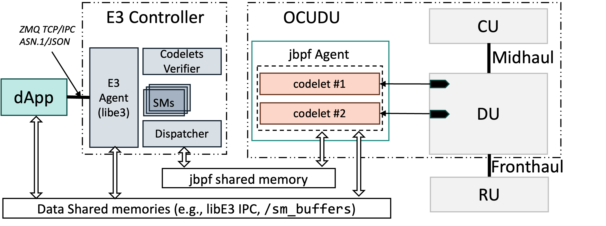









The [E3 Controller](https://github.com/wineslab/E3Controller) is a standalone C++ daemon that brings dApps to the [OCUDU](https://github.com/wineslab/ocudu-e3) gNB.
It loads [jbpf](https://github.com/microsoft/jbpf) codelets into the gNB, collects their output through jbpf's IPC shared memory, and serves it to dApps over the E3 interface using [libe3](https://github.com/wineslab/libe3).
In the other direction, it takes the dApps' control actions and applies them in the gNB's scheduler.
This tutorial shows how to build the gNB and the controller, configure them, and connect a dApp.
{: .text-justify}

If you have not used dApps before, start with the [dApp Framework Tutorial](/tutorials/dapps-oai), which covers the dApp library and the E3 Application Protocol (E3AP) on OpenAirInterface.
{: .text-justify}

---

## Overview

The E3 Controller runs as a daemon process beside the gNB.
It is the jbpf **IPC primary**, while the jbpf-based gNB is the **IPC secondary**.
It exposes two RAN functions, one Service Model (SM) each:
{: .text-justify}

| RAN function | Service Model | What it does |
|---|---|---|
| RF=1 | **Spectrum** | Receives a dApp's PRB blacklist control and applies it in the gNB's scheduler: PDSCH and PUSCH avoid the blocked PRBs, UL and DL, until the next control replaces the list. |
| RF=2 | **L1-KPM** | Sends one indication per uplink slot that points to the slot's frequency-domain I/Q samples in a shared-memory region (`/e3_ran_buffers`). The payload conforms to [NVIDIA Aerial's E3 message schema](https://github.com/NVIDIA/aerial-sample-apps/blob/main/dapps/docs/e3_message_schemas.json), in JSON or ASN.1 (APER). |

The figure below shows the architecture.
The data path is zero-copy: the codelet in the gNB writes the I/Q samples straight into a data shared memory that the dApp reads, and only a ~64 B descriptor crosses the jbpf shared memory, so the samples never pass through the controller.
{: .text-justify}



Codelets are loaded **on demand**: the first dApp subscription to a RAN function loads its codelet into the gNB, and the last unsubscription unloads it.
{: .text-justify}

For the details, see the controller's [architecture](https://github.com/wineslab/E3Controller/blob/main/docs/architecture.md) and [service models](https://github.com/wineslab/E3Controller/blob/main/docs/service-models.md) documents.
{: .text-justify}

---

## Components

- [ocudu-e3](https://github.com/wineslab/ocudu-e3) (branch `e3`): the OCUDU gNB with the jbpf hooks and the gNB-side E3 publish helper (`26.10` tag).
- [E3Controller](https://github.com/wineslab/E3Controller): the controller, its jbpf codelets and the offline codelet verifier. It pins [libe3](https://github.com/wineslab/libe3) as a submodule.
- A dApp. Any dApp that speaks the L1-KPM or Spectrum SM, for example the spectrum sharing dApp of the [dApp library](https://github.com/wineslab/dApp-library) or the [NVIDIA Aerial dApps](https://github.com/NVIDIA/aerial-sample-apps/tree/main/dapps).

**Requirements.** Ubuntu 22.04 or 24.04, on an x86_64 CPU with AVX2 and F16C (Haswell or newer) or on aarch64.
The gNB-side publish helper needs these instructions, because it converts every uplink slot in the PHY RX thread.
{: .text-justify}

---

## Step 1: Clone the repositories

The controller is built against the gNB's own jbpf tree, so clone the two repositories **side by side** and keep the folder name `ocudu-e3`:
{: .text-justify}

```bash
git clone --branch e3 https://github.com/wineslab/ocudu-e3.git
git -C ocudu-e3 submodule update --init --recursive

git clone --recurse-submodules https://github.com/wineslab/E3Controller.git
```

The `--recursive` flag matters: jbpf vendors its own third-party submodules (`ck`, `ubpf`, `ebpf-verifier`, `mimalloc`).
{: .text-justify}

## Step 2: Build the gNB with jbpf

Install the dependencies of OCUDU and jbpf:
{: .text-justify}

```bash
sudo apt-get install -y --no-install-recommends \
    ca-certificates git patch \
    cmake make build-essential pkg-config \
    libfftw3-dev libmbedtls-dev libsctp-dev libyaml-cpp-dev libgtest-dev \
    libzmq3-dev \
    libboost-dev libboost-program-options-dev libboost-filesystem-dev \
    libasan6 python3 python3-pip clang gcc-multilib \
    libelf-dev libpcap-dev doxygen gcovr
```

On arm64, install `libc6-dev` instead of `gcc-multilib`.
{: .text-justify}

Patch jbpf once, then build the gNB with `ENABLE_JBPF=ON`:
{: .text-justify}

```bash
cd ocudu-e3
./apply_jbpf_patches.sh

cmake -S . -B build -DENABLE_JBPF=ON -DENABLE_DPDK=True \
      -DENABLE_ZEROMQ=ON -DENABLE_UHD=OFF -DASSERT_LEVEL=MINIMAL \
      -DCMAKE_BUILD_TYPE=Release -DBUILD_TESTING=OFF
cmake --build build -j"$(nproc)" --target gnb
cd ..
```

The binary lands at `ocudu-e3/build/apps/gnb/gnb`.
Adjust `ENABLE_DPDK`, `ENABLE_ZEROMQ` and `ENABLE_UHD` to your radio front-end; `ENABLE_JBPF` is independent of them.
{: .text-justify}

`ENABLE_JBPF=ON` compiles jbpf in-tree, adds the hooks to the fronthaul receiver, the upper PHY and the scheduler, and builds the E3 publish helper.
At configure time, it also compares the E3 headers it shares with `../E3Controller` byte for byte, and stops if they differ: always build the two sides from matching versions.
{: .text-justify}

## Step 3: Build the E3 Controller and its codelets

Build the gNB first and the controller after: both compile the same jbpf tree, so **do not run the two builds at the same time**.
{: .text-justify}

```bash
cd E3Controller

# On a fresh Debian/Ubuntu machine, install the toolchain first (asn1c, libzmq, ...):
./build.sh --install-deps
# On a machine that already has it:
./build.sh
```

`build.sh` finds `../ocudu-e3`, builds libe3 with both encoders (ASN.1 and JSON) and installs it under `/usr/local`, then builds the controller.
The binary lands at `out/bin/e3_controller`.
{: .text-justify}

Some useful overrides:
{: .text-justify}

```bash
OCUDU_DIR=$HOME/src/my-ocudu ./build.sh   # the ocudu checkout is somewhere else
LIBE3_PREFIX=$HOME/.local ./build.sh      # install libe3 without sudo
JOBS=8 ./build.sh                         # build parallelism
```

Then build the offline verifier and the codelets:
{: .text-justify}

```bash
cmake --build build --target e3_verifier_cli
make -C codelets
```

`make` verifies every codelet and fails if one does not verify.
This check is not optional: the gNB never verifies the codelets it loads, and jbpf's JIT emits no memory bounds checks, so this build step is the only memory-safety gate the codelets pass through.
{: .text-justify}

## Step 4: Configure

### The E3 Controller

The controller takes a single argument, a YAML file. Unknown keys are a startup error, so a typo cannot be silently ignored.
Two example files ship with the repository: `configs/e3_controller_asn1.yaml` (ASN.1, libe3's default ports) and `configs/e3_controller.yaml` (JSON, the port convention of NVIDIA Aerial dApps).
The main sections, for a 100 MHz, 30 kHz SCS, 4x4 cell and ASN.1 dApps, are:
{: .text-justify}

```yaml
# Radio geometry: MUST match the running gNB.
radio:
  nof_ports:   4        # UL antenna ports
  nof_prbs:    273      # 100 MHz @ 30 kHz SCS
  nof_symbols: 14
  scs_khz:     30

# The region the controller owns, the gNB writes and the dApp reads.
shm:
  name:        /e3_ran_buffers
  size_bytes:  176117824   # 64 B header + 2 x 120 rows x 733,824 B
  cbf16_scale: 1.0
  writer:      gnb

# Must agree with the gNB's own jbpf: section (below).
jbpf:
  ipc_name:          e3_controller
  run_path:          /dev/shm
  mem_size_bytes:    1073741824
  codelet_base_path: /path/to/E3Controller/codelets   # as seen by the gNB

# One encoding per process; dApps must speak the same one.
e3:
  encoding:        asn1     # asn1 | json
  link_layer:      zmq      # zmq | posix
  transport:       tcp      # tcp | ipc | sctp
  setup_port:      9990
  publisher_port:  9991
  subscriber_port: 9999

threads:            # -1 = no pinning
  poll_core:        2
  worker_core:      3
  publisher_core:   4
  poll_interval_us: 100

prb_block:
  enabled: true     # apply the dApps' PRB blacklist in the gNB's scheduler
```

A few notes on these values:
{: .text-justify}

- **`radio` is checked, not trusted.** The controller compares it with the first slot the gNB delivers and refuses to publish on a mismatch, naming both sides.
- **`codelet_base_path`** is resolved by the gNB when it loads a codelet, so it must be the path as the gNB sees it (this matters in containers).
- **Pin the threads** to cores that exist, that are not used by the gNB, and that are disjoint from the dApp's. Unpinned threads cost latency.
- **JSON dApps.** For NVIDIA Aerial dApps, use `encoding: json` with ports `5555`/`5556`/`5557`. To serve ASN.1 and JSON dApps at the same time, run two controllers on different ports.

Every key is documented in the controller's [usage guide](https://github.com/wineslab/E3Controller/blob/main/docs/usage.md).
{: .text-justify}

### The gNB

Add a `jbpf:` section to the gNB's configuration file that matches the controller.
The gNB's defaults do not match (standalone mode, IPC name `ocudu_ipc_app`, run path `/tmp`), so set them explicitly:
{: .text-justify}

```yaml
jbpf:
  jbpf_enable_ipc: 1                  # IPC secondary
  jbpf_ipc_mem_name: "e3_controller"  # = the controller's jbpf.ipc_name
  jbpf_run_path: "/dev/shm"           # = the controller's jbpf.run_path
  jbpf_namespace: "jbpf"
  jbpf_io_mem_size_mb: 1024           # = the controller's jbpf.mem_size_bytes
  jbpf_enable_lcm_ipc: 1
  jbpf_lcm_ipc_name: "jbpf_lcm_ipc"
```

The gNB serves codelet loading (LCM) at `<jbpf_run_path>/<jbpf_namespace>/<jbpf_lcm_ipc_name>`, here `/dev/shm/jbpf/jbpf_lcm_ipc`.
The controller derives the same path from its `run_path`, unless `jbpf.lcm_socket_path` is set.
{: .text-justify}

## Step 5: Run

The order matters: the controller is the IPC primary, so it **must start before the gNB**.
Open three terminals.
{: .text-justify}

| Order | Component | Command |
|---|---|---|
| 1 | E3 Controller | `./out/bin/e3_controller --config configs/e3_controller_asn1.yaml` (from `E3Controller/`) |
| 2 | gNB | `sudo ./build/apps/gnb/gnb -c <your_gnb_config>.yml` (from `ocudu-e3/`) |
| 3 | dApp | see below |

The controller does not touch the gNB's codelet loader until the first dApp subscribes, so the gNB only has to be up by then.
{: .text-justify}

### Connect a dApp

<!-- TODO: dApp instructions -->

## What to expect

- At startup, the controller prints its E3 and codelet configuration and creates `/dev/shm/e3_ran_buffers`.
- When the dApp subscribes, the controller loads the `uplink_slot_samples` codelet (and, with `prb_block.enabled`, the `prb_block` codelet) into the gNB, and the dApp starts receiving one L1-KPM indication per uplink slot.
- When the dApp sends a PRB blacklist, the controller prints a `[PrbBlockRelay]` line each second with the blocks it received, sent and saw applied. With `log: mac_level: info`, the gNB also logs each new block (`PRB block id=...`).
- When the controller stops (Ctrl+C), it unloads the codelets, which clears any PRB block, and prints a summary of the published and dropped slots, by reason.

## Going further

### Sense only the slots no UE transmits in

A sensing dApp often wants spectrum that no UE of the cell is using, otherwise it sees the UEs' PUSCH as interference and blocks it.
With `slot_filter.ue_free_only: true`, the gNB publishes only the uplink slots in which its PHY expects no PUSCH, PUCCH or SRS.
The decision is made in the codelet, before any I/Q moves, so a skipped slot costs the gNB nothing.
By default the gNB asks the RU only for uplink slots that have something scheduled, so to capture the empty ones too, add to the gNB configuration:
{: .text-justify}

```yaml
expert_phy:
  allow_request_on_empty_uplink_slot: true
```

To keep only some slots of the 10 ms frame, list their indices in `slot_filter.slots` (for example `[8, 9, 18]`).
{: .text-justify}

### Measure latency

Build libe3 with its stage recorder to trace every stage, from the gNB hook to the dApp:
{: .text-justify}

```bash
rm -rf libe3/build
./build.sh --latrec
```

Set `logging.latrec_dir` to choose where the rings are written, and `logging.drops_log_path` for a per-second CSV of published and dropped slots.
See [Stage records](https://github.com/wineslab/E3Controller/blob/main/docs/stage-records.md) for how to read a capture.
{: .text-justify}

## Troubleshooting

- **Configure of ocudu stops on an E3 header mismatch.** The gNB and the controller come from different versions: check out matching commits of both.
- **The controller refuses to publish with a geometry mismatch.** `radio:` does not match the gNB's cell: fix the ports, PRBs or SCS.
- **The gNB does not connect to the controller.** Start the controller first, and check that the gNB's `jbpf:` section matches the controller's `jbpf:` section.
- **A codelet fails to load with `call to nonexistent function`.** The codelets, the verifier and the gNB disagree on the helper IDs: rebuild the codelets against the same `ocudu-e3` checkout as the gNB.
- **The dApp connects but receives nothing.** Check that its link layer, transport, encoding and ports match the controller's `e3:` section, and that both use the same libe3 release.

Known limitations, such as the PRB block covering data channels only, are listed in the controller's [documentation](https://github.com/wineslab/E3Controller/blob/main/docs/known-limitations.md).
{: .text-justify}

---

If you use the E3 Controller in your work, please cite our paper:
> {{ pub_feraudo2026e3controller | strip_newlines }}
> {: .text-justify}
